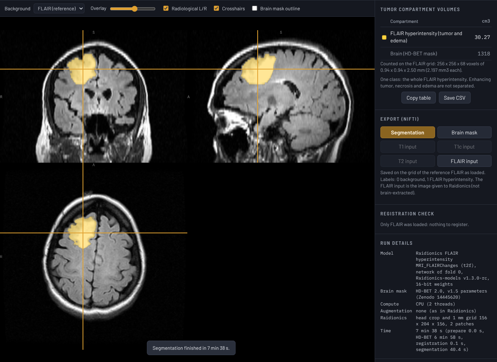
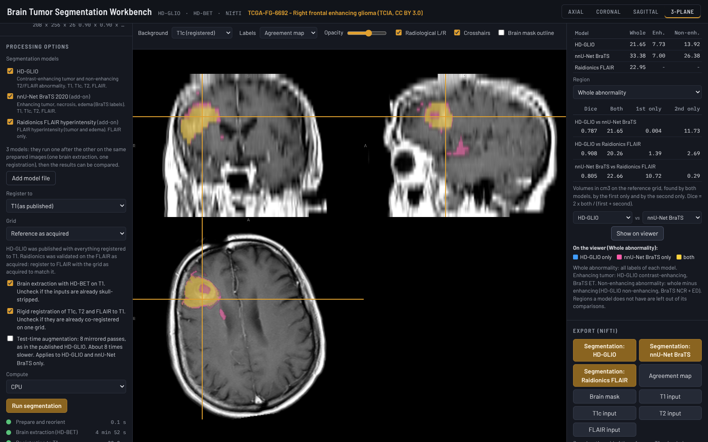

# Brain Tumor Segmentation Workbench

A standalone, offline tool for automated brain tumor segmentation with **HD-GLIO**
(Kickingereder, Isensee et al., Lancet Oncol 2019) or add-on models: the **nnU-Net BraTS 2020**
model (Isensee et al.), which also separates necrosis; the **Raidionics FLAIR hyperintensity**
model (Faanes, Bouget et al., Sci Rep 2026), which needs only a FLAIR and suits non-enhancing
gliomas; the **Raidionics tumor core** model (Bouget et al., Front Neurol 2026), which needs
only a T1c and was trained on gliomas, meningiomas and metastases; the **AURORA** brain metastasis
models (Buchner et al., Radiother Oncol 2023), on T1c alone or T1c and FLAIR; and the **vestibular
schwannoma** models of Kujawa et al. (Front Comput Neurosci 2024), on T1c or T2. Drop in a DICOM folder, a `.zip` or NIfTI files. It finds the T1, T1c, T2
and FLAIR series, prepares them as the HD-GLIO instructions prescribe (reorientation, HD-BET brain
extraction, rigid registration to a reference sequence, masking), runs the chosen model and shows
the result on a 3-plane viewer with the compartment volumes in cm3. Several models can run on the
same prepared images in one go and be compared, as volumes, Dice and an agreement overlay. The
segmentations and the prepared inputs are saved as NIfTI. All processing happens on the computer
it runs on.


## What it measures

| Label | Compartment | Model class name |
|---|---|---|
| 1 | Non-enhancing T2/FLAIR signal abnormality | `edema` |
| 2 | Contrast-enhancing tumor | `km` (Kontrastmittel) |
| 1 + 2 | Total abnormality | |

HD-GLIO has no separate necrosis class. The **nnU-Net BraTS 2020** add-on uses the BraTS label
convention:

| Label | Compartment |
|---|---|
| 1 | Necrosis / non-enhancing tumor core (NCR) |
| 2 | Peritumoral edema / infiltrated tissue (ED) |
| 4 | Enhancing tumor (ET) |
| 1 + 4 | Tumor core (TC) |
| 1 + 2 + 4 | Whole tumor (WT) |

The **Raidionics FLAIR hyperintensity** add-on has one label:

| Label | Compartment |
|---|---|
| 1 | FLAIR hyperintensity (tumor and edema, not separated) |

For a non-enhancing glioma this is the tumor extent on FLAIR; around an enhancing tumor it also
includes edema.

The **Raidionics tumor core** add-on also has one label:

| Label | Compartment |
|---|---|
| 1 | Tumor core: enhancing tissue, necrosis and cysts (edema not included) |

It was trained on preoperative gliomas, meningiomas and metastases. In a non-enhancing glioma it
labels the T1-hypointense part of the tumor rather than enhancement (on TCGA-DU-7294, 9.7 cm3,
96% of it inside the FLAIR lesion), so it is not a measure of enhancement on its own. Run it with
the Raidionics FLAIR model for the core and the surrounding FLAIR signal, as Raidionics reports
contrast-enhancing tumors.

The **AURORA** add-ons (brain metastases) have two labels:

| Label | Compartment |
|---|---|
| 1 | Edema (FLAIR hyperintensity around the metastasis) |
| 2 | Metastasis: contrast-enhancing tumor and necrosis |
| 1 + 2 | Total |

Two input combinations are offered: T1c alone, which the authors found best for finding and
outlining metastases, and T1c with FLAIR, which is better for edema (models with FLAIR found more
false-positive lesions in their test).

The **vestibular schwannoma** add-ons have one label each:

| Label | Compartment |
|---|---|
| 1 | Vestibular schwannoma (intra- and extrameatal) |

One model takes a contrast-enhanced T1, the other a T2 (trained mostly on high-resolution images
such as CISS or FIESTA). They take the image as it is: no brain extraction, so with these models
alone HD-BET is not run.



*The Raidionics FLAIR add-on on the FLAIR of TCGA-DU-7294 (TCIA, CC BY 3.0) loaded on its own:
30.27 cm3 of FLAIR hyperintensity, the same as the original Raidionics code to 2 voxels.*

The volumes table lists each compartment in cm3, counted on the grid of the reference sequence,
plus the HD-BET brain volume when a model used the brain mask. **Copy table** and **Save CSV** export it. The CSV carries the
models, grid and options used, and no patient information.

### Comparing models

Check more than one model under *Segmentation models* and they run one after the other on the
same prepared images (one brain extraction, one registration, one reference grid), so their
outputs line up voxel for voxel. Each model keeps the preparation it was validated with: HD-GLIO,
the BraTS model and AURORA get the brain-extracted images, Raidionics and the schwannoma models
the image as it is. The
**Model comparison** panel then shows:

- the volume of each shared region per model, for the regions below;
- for the chosen region, every pair of models: Dice, and the volume found by both, by the first
  only and by the second only (cm3);
- **Show on viewer**: an agreement map of the chosen pair (first only, second only, both), also
  under *Labels* above the viewer, and exportable as NIfTI (1 first only, 2 second only, 3 both).

| Region | HD-GLIO | nnU-Net BraTS 2020 | Raidionics FLAIR | Raidionics tumor core | AURORA | Schwannoma |
|---|---|---|---|---|---|---|
| Whole abnormality | 1 + 2 | 1 + 2 + 4 (WT) | 1 | - | 1 + 2 | 1 |
| Tumor core | - | 1 + 4 (TC: NCR + ET) | - | 1 | 2 (metastasis) | - |
| Enhancing tumor | 2 | 4 (ET) | - | - | - | - |
| Non-enhancing abnormality | 1 | 1 + 2 (NCR + ED) | - | - | - | - |

HD-GLIO is left out of the tumor core: its published label definitions exclude necrosis from the
non-enhancing label but do not say whether the enhancing label includes it. AURORA's metastasis
label (enhancing tumor and necrosis) is a tumor core; its edema label is not compared, because the
BraTS non-enhancing region also holds necrosis. Models that share no region (for example HD-GLIO
and the tumor core model) are listed with their volumes only.

The models were trained on different definitions (HD-GLIO has no necrosis class; BraTS separates
necrosis from edema; Raidionics outlines the FLAIR hyperintensity), so a Dice below 1 reflects
both disagreement and these differences. *Save CSV* then holds the compartment volumes of every
model, the region volumes and the pairwise agreement in one table.



*HD-GLIO, the nnU-Net BraTS model and Raidionics FLAIR run together on the TCGA-FG-6692 demo
(registered to T1), with the agreement map of HD-GLIO and BraTS for the whole abnormality: HD-GLIO
only (blue), BraTS only (pink), both (yellow). Whole abnormality Dice 0.787 (HD-GLIO vs BraTS),
0.908 (HD-GLIO vs Raidionics), 0.805 (BraTS vs Raidionics); enhancing tumor 0.900 (HD-GLIO vs
BraTS).*

## Download

The ready-to-run files are in [`downloads/`](downloads). Nothing needs to be installed and no
admin rights are needed.

| File | Runs on | Size |
|---|---|---|
| [`BrainTumorSegmentationWorkbench.exe`](downloads/BrainTumorSegmentationWorkbench.exe) | Windows 10/11 (x64) | 71 MB |
| [`BrainTumorSegmentationWorkbench-macOS-AppleSilicon.zip`](downloads/BrainTumorSegmentationWorkbench-macOS-AppleSilicon.zip) | macOS 11+, Apple M-series | 67 MB |
| [`BrainTumorSegmentationWorkbench-macOS-Intel.zip`](downloads/BrainTumorSegmentationWorkbench-macOS-Intel.zip) | macOS 11+, Intel | 67 MB |
| [`BrainTumorSegmentationWorkbench-model-BraTS2020-nnUNet.btsmodel`](downloads/BrainTumorSegmentationWorkbench-model-BraTS2020-nnUNet.btsmodel) | Optional add-on model for any of the above | 58 MB |
| [`BrainTumorSegmentationWorkbench-model-Raidionics-FLAIR.btsmodel`](downloads/BrainTumorSegmentationWorkbench-model-Raidionics-FLAIR.btsmodel) | Optional add-on model for any of the above | 44 MB |
| [`BrainTumorSegmentationWorkbench-model-Raidionics-TumorCore.btsmodel`](downloads/BrainTumorSegmentationWorkbench-model-Raidionics-TumorCore.btsmodel) | Optional add-on model for any of the above | 44 MB |
| [`BrainTumorSegmentationWorkbench-model-AURORA-T1c.btsmodel`](downloads/BrainTumorSegmentationWorkbench-model-AURORA-T1c.btsmodel) | Optional add-on model for any of the above | 11 MB |
| [`BrainTumorSegmentationWorkbench-model-AURORA-T1c-FLAIR.btsmodel`](downloads/BrainTumorSegmentationWorkbench-model-AURORA-T1c-FLAIR.btsmodel) | Optional add-on model for any of the above | 11 MB |
| [`BrainTumorSegmentationWorkbench-model-VS-T1c.btsmodel`](downloads/BrainTumorSegmentationWorkbench-model-VS-T1c.btsmodel) | Optional add-on model for any of the above | 58 MB |
| [`BrainTumorSegmentationWorkbench-model-VS-T2.btsmodel`](downloads/BrainTumorSegmentationWorkbench-model-VS-T2.btsmodel) | Optional add-on model for any of the above | 57 MB |

**Add-on models.** To use an add-on model, download its `.btsmodel` file and put it in the same
folder as the program (for example both in Downloads). It then appears under *Processing
options > Segmentation models*. Alternatively open it with **Add model file** (for that session
only). The add-ons are separate files because the program and the models together would exceed
GitHub's 100 MB file limit. Each file is checked (format and checksum) before use.

Each file contains everything: the page, the viewer, ONNX Runtime and both networks.

Checksums: [`downloads/SHA256SUMS.txt`](downloads/SHA256SUMS.txt).

**Windows:** double-click the `.exe`. On first run SmartScreen may say "Windows protected your
PC". Click **More info**, then **Run anyway**. The workbench opens in its own Edge (or Chrome)
window and the program quits by itself about 30 seconds after that window is closed.

**macOS:** unzip, then double-click **Brain Tumor Segmentation Workbench**. The first time,
macOS blocks it because it is not signed by a registered developer: open **System Settings >
Privacy & Security** and click **Open Anyway**.

A run needs about 3 to 4 GB of free memory (the browser holds the volumes and the network's
patches). A FLAIR-only run with the Raidionics model, whose patches are 160^3, peaked at about
4 GB across all browser processes on the test machine. Running several models at once needs no
more: each network is released before the next is loaded (all three models also peaked at
4 GB).

The executables are unsigned. Workstations that allow only approved software may block them
until IT approves them.

## Using it

1. **Load a study.** Drop a DICOM folder or `.zip`, or NIfTI files, or pick the demo case. HD-GLIO
   and the BraTS model need all four sequences; the Raidionics FLAIR model needs only the FLAIR,
   the Raidionics tumor core and AURORA T1c models only the T1c, AURORA T1c+FLAIR those two, and
   the schwannoma models the T1c or the T2.
   DICOM may be uncompressed, RLE, JPEG lossless, JPEG-LS or JPEG 2000, single- or multi-frame
   (enhanced MR). Series with fewer than 3 slices are skipped; localisers, diffusion, perfusion
   and other series are listed but not assigned automatically.
2. **Check the sequences.** T1, T1c, T2 and FLAIR are guessed from the series descriptions and
   headers (TR, TE, TI, contrast agent) or the NIfTI file names. When three are recognised and
   exactly one series is left over, it takes the remaining slot and is marked *by elimination -
   check it*. Change any of them in the drop-downs. The checked models decide which are needed:
   with the Raidionics FLAIR model alone, T1, T1c and T2 are optional (with the tumor core model
   alone, all but the T1c), and any that are chosen are registered to the reference and can be
   shown as background.
3. **Options.**
   - *Segmentation models*: HD-GLIO (built in) and any add-on models (nnU-Net BraTS 2020,
     Raidionics FLAIR hyperintensity, Raidionics tumor core, AURORA T1c and T1c+FLAIR, vestibular
     schwannoma T1c and T2). Check one or more; with more than one, the results can be
     compared (see Comparing models).
   - *Register to*: the reference sequence. T1, as HD-GLIO was published, or T1c, FLAIR or T2, for
     example when that sequence has the thinnest slices. For the schwannoma T2 model, register to
     T2 with the grid as acquired, so that the thin-slice T2 is not resampled. HD-BET runs on the reference, the other
     three are registered to it, and the volumes and exports are on its grid. The brain-mask
     volume depends on which sequence HD-BET sees, so compare brain volumes only within one
     choice.
   - *Grid*: the reference as acquired, or resampled to 1 mm isotropic.
   - *Brain extraction with HD-BET*: switch off if the inputs are already skull-stripped. Not
     run when only the schwannoma models are checked, which use the whole-head image.
   - *Registration*: switch off if the four images are already co-registered on one grid. It is
     switched off automatically when four NIfTI files share one grid.
   - The reference, grid and model choices are remembered in this browser.
   - *Test-time augmentation*: the published HD-GLIO averages 8 mirrored predictions. It is off by
     default because it takes about 8 times longer; switch it on to reproduce the published
     setting exactly. It applies to the nnU-Net models (8 mirrored passes) and AURORA, and not to
     Raidionics, which does not use it. AURORA's own augmentation averages 13 passes: the image as
     is, 4 times with a little Gaussian noise (standard deviation 0.001 of the intensity range) and
     4 times each flipped on two axes. Without the noise these are 5 identical passes and 4 + 4
     flipped ones, so the workbench runs 3 passes weighted 5 : 4 : 4 (see VERIFICATION.md for how
     close that is).
   - With a Raidionics model, register to its input sequence (FLAIR, or T1c for the tumor core
     model) with the grid as acquired to run it exactly as Raidionics does (the page says so when
     another choice is made). When it runs together with other models, all of them are then on
     that grid; with both Raidionics models, one of them necessarily runs on a registered image.
   - *Compute*: automatic uses the GPU through WebGPU when there is one, otherwise the CPU. If
     the GPU stops responding during a run, that step restarts on the CPU and the run finishes
     there (see Troubleshooting).
4. **Run segmentation.** Progress is shown per step. On the CPU of a 2-core test machine the
   demo case took 9 minutes (HD-BET 5.4 min, registration 0.7 min, HD-GLIO 2.9 min), or 32
   minutes with test-time augmentation. The Raidionics model on the FLAIR of TCGA-DU-7294 alone
   took 7.5 minutes (HD-BET 6.8 min, Raidionics 0.7 min). With several models, the preparation
   runs once and each model adds its own time (all three models on the demo: 13.7 minutes). Each
   AURORA model took 5.5 minutes on a 1 mm image. The schwannoma models are slower, because they
   work at the resolution of thin-slice images: 29 minutes for the T1c model on its 0.41 x 0.41 x
   1.5 mm example (75 patches)VST2TIME. More CPU cores, or a GPU through WebGPU, make it
   considerably faster.
5. **Review.** Axial, coronal, sagittal (anterior to the left) or 3-plane view. Choose the
   background sequence, which model's labels (or the agreement map) are shown, the overlay
   opacity, crosshairs on or off, and which compartments are shown (click a colour swatch). The
   *Registration
   check* lists each sequence's rotation and shift and flags large ones. Switch the background
   to each registered sequence to confirm the alignment.
6. **Export.** Each model's segmentation, the agreement map (with several models), the brain
   mask and the prepared inputs as `.nii.gz` (inputs are brain-extracted as HD-GLIO, the BraTS
   model and AURORA got them; with Raidionics or a schwannoma model alone, the image as given to
   it, which is not brain-extracted; other sequences as registered). Files are on
   the reference grid with the same voxel order and orientation as the reference series that was
   loaded, so they overlay it in any viewer.

## Troubleshooting

**"The GPU stopped responding" / "[Device] is lost".** The browser lost its GPU while a network
was running. On Windows this is usually the graphics driver's 2-second timeout (TDR): one
network layer on a 3D patch can take longer than that on integrated or modest GPUs, and Windows
then resets the GPU. Running out of GPU memory has the same effect. Since version 1.0.1 the
workbench restarts that step on the CPU and finishes the run there (same result, slower), keeps
using the CPU for the rest of the session, and remembers it on that computer: *Automatic* then
uses the CPU. Choose *GPU* under *Compute* to try the GPU again. With version 1.0.0 the run
stopped with this error; choose *CPU* under *Compute* to avoid it.

## Pipeline

Following the [HD-GLIO instructions](https://github.com/NeuroAI-HD/HD-GLIO):

| Step | HD-GLIO instructions (FSL / Python) | Workbench |
|---|---|---|
| Reorient | `fslreorient2std` | Axis permutation and flips to the MNI152 voxel order (LAS), exact |
| Brain mask | `hd-bet` on T1 | HD-BET 2.0 (v1.5 parameters) on the reference (T1 by default; T1c or FLAIR if chosen); largest connected component kept |
| Registration | `flirt -dof 6 -interp spline` to T1 | 6-parameter rigid registration to the reference by normalised mutual information (coarse search at 4 mm, then 6 / 3 / 1.5 mm), cubic B-spline resampling |
| Masking | `fslmaths -mas` with the T1 brain mask | Same, with the reference's brain mask |
| Segmentation | `hd_glio_predict` (nnU-Net v1, fold 0) | The same network and nnU-Net v1 prediction steps reimplemented in JavaScript (see VERIFICATION.md). The BraTS add-on runs through the same code, with nnU-Net's region-based output handling |

**Agreement with the original models** (demo case, identical inputs, PyTorch on CPU as the
reference; details in [VERIFICATION.md](VERIFICATION.md)): HD-GLIO differs at 18 of 1.49 million
voxels (Dice 0.9989 enhancing, 0.9971 non-enhancing; volumes within 0.08 cm3). With test-time
augmentation on both sides, 22 voxels differ (Dice 0.9991 / 0.9965). The HD-BET mask differs at
184 boundary voxels (Dice 0.99975). The nnU-Net BraTS 2020 add-on differs from the original
PyTorch network at 1 voxel (Dice 1.0 for ET, NCR and TC; 0.99991 for ED). The Raidionics FLAIR
add-on, against the original raidionicsseg code on the same FLAIR and brain mask, differs at
2 voxels on TCGA-DU-7294 (Dice 0.99993; 30.27 cm3 on both sides) and at 3 on TCGA-FG-6692
(Dice 0.99972; 24.10 vs 24.09 cm3). The Raidionics tumor core add-on, on the T1c with the same
brain mask, differs from raidionicsseg at 4 voxels on TCGA-DU-7294 (Dice 0.99955; 9.74 vs 9.73 cm3)
and at 5 on TCGA-FG-6692 (Dice 0.99889; 9.97 vs 9.95 cm3). The AURORA T1c add-on, against
brainles_aurora on the same 1 mm images, differs at 5 to 8 of 8.9 million voxels (metastasis Dice
1.0, edema 0.9999); run on BraTS-style files in the browser, metastasis Dice 0.9998 and edema 0.997
against AURORA on the files themselves. The schwannoma T1c add-on differs from the original
nnU-Net v2 predictor at 2 of 16.4 million voxels on the model's example image (Dice 0.99993;
3.761 cm3 on both sides)VST2README.

**Weight precision.** HD-GLIO and HD-BET are stored as 8-bit integers per output channel and
restored to 32-bit floating point at load, which keeps the executable under GitHub's 100 MB file
limit. The add-on models are stored at 16-bit precision. The agreement figures above are for the
shipped files.

**About the BraTS model.** It is one network (fold 0) of the region-based configuration
(`nnUNetTrainerV2BraTSRegions_DA4_BN_BD`) of Isensee et al.'s BraTS 2020 entry, which won the
challenge as an ensemble of 25 such networks; a single network is expected to score slightly
lower than that ensemble. BraTS training images were registered to the SRI24 atlas; the
workbench runs the model in native space, on the same prepared inputs as HD-GLIO.

**About the Raidionics models.** The FLAIR model is `MRI_FLAIRChanges` (`t2f`) from the Raidionics-models
release v1.3.0-rc, the model that the Raidionics software (SINTEF Digital, Norway) uses
for non-contrast-enhancing tumors, described as a unified FLAIR hyperintensity model for
glioblastoma, lower-grade glioma, meningioma and metastasis, before and after surgery, trained on
about 5,000 FLAIR scans from many centers (Faanes et al., Sci Rep 2026). The paper reports a mean
Dice of 84.5% for preoperative lower-grade gliomas. The workbench runs the network of fold 0, as
the Raidionics software does by default.

The tumor core model is `MRI_TumorCore` (`t1c`) from the same release, the model Raidionics uses
for preoperative contrast-enhancing tumors. Bouget et al. (Front Neurol 2026) trained it on 7,171
preoperative T1c investigations and report, over 5-fold cross-validation, a voxel-wise Dice of
89% for gliomas, 86% for meningiomas and 85% for metastases, with the tumor found in 99.7%,
98.3% and 98.8% of patients. The training cohorts are largely surgical; how it does on the small,
multiple metastases of radiosurgery practice is not reported in the main text.

Neither Raidionics model uses the HD-GLIO preparation: each takes its image as it is (no skull
stripping), and `app/js/lib/raidionics.js` repeats raidionicsseg's own steps, which are the same
for both models:

| Step | raidionicsseg 1.5.2 / raidionics_rads_lib 1.3.3 | Workbench |
|---|---|---|
| Head crop | Bounding box of voxels >= 20% of the intensity range | Same |
| Resampling | `nibabel.processing.resample_to_output`, 1 mm, linear | Same arithmetic as scipy's `affine_transform` |
| Intensities | Negatives to 0, clipping at the 0 and 99.5th percentiles, z-score of the nonzero voxels | Same |
| Inference | 160^3 patches without overlap (the last one moved inside), maximum where they meet, sigmoid | Same |
| Back to the input grid | Linear resampling of the probabilities, threshold 0.5 | Same |
| Refinement | Keep connected regions that touch the brain mask (Raidionics' own brain model) | Same rule, with the HD-BET mask |

**About the AURORA models.** AURORA (BrainLesion; Buchner et al., Radiother Oncol 2023) is a
MONAI BasicUNet for brain metastases. In the first study, a network trained on 260 patients from
two centers reached an overall Dice of 0.92 and a detection F1 of 0.93 for the metastasis in an
external test cohort of 88 patients from four centers. The
follow-up study of input combinations (Buchner et al., Radiother Oncol 2023;188:109901) found
T1c alone best for the metastasis (Dice 0.96, detection F1 0.97 in their test) and FLAIR needed
for edema. The workbench offers those two combinations, the `best` weights of release v1.0.0.

AURORA's own code takes the images as given and expects them brain-extracted, 1 mm and in BraTS
(SRI-24) space, as its training data were. The workbench gives it the HD-BET-masked, registered
images on a 1 mm grid with the BraTS axis order (left, posterior, superior), 240 x 240 x 155
voxels around the brain. It is aligned with the scanner axes, not registered to the atlas, so a
strongly tilted head is not straightened. When the reference is already 1 mm and axis-aligned,
that grid is placed on the reference's own voxels, so nothing is interpolated; otherwise the
images are resampled linearly and the probabilities are resampled back before thresholding.
`app/js/lib/aurora.js` then repeats brainles_aurora's steps: intensities scaled from the 0.5th to
the 99.5th percentile to 0..1, sliding window of 192 x 192 x 32 with half overlap and Gaussian
weighting (MONAI's), sigmoid >= 0.5 for the whole lesion and the metastasis.

**About the schwannoma models.** Kujawa et al. (King's College London; Front Comput Neurosci
2024) trained nnU-Net v2 on routine MRI from 10 UK hospitals (MC-RC) and on Gamma Knife planning
MRI (SC-GK); the workbench uses the models trained on both, which the paper found best on most
test sets (contrast-enhanced T1: mean Dice 0.904 on the multi-centre test set, against 0.869 for
the multi-centre-only model; T2: 0.852), the network of fold 0 of the selected `3d_fullres`
configuration. The patients had one sporadic tumor; NF2 was excluded. The images are used as
they are, without brain extraction (the training images were not skull-stripped). nnU-Net chose a
keep-the-largest-region postprocessing on cross-validation, but the authors' instructions on
Zenodo say to omit it, so it is not applied.

The networks run with [ONNX Runtime Web](https://onnxruntime.ai): WebGPU when available,
otherwise multi-threaded WebAssembly on the CPU.

## Privacy and offline use

- Works with no internet connection. The demo case and a DICOM study were tested end to end in a
  sandbox with no network.
- No imaging data or patient information is sent anywhere. The program makes **no** outbound
  requests: fonts, viewer, runtime and networks are all inside the executable, and the page's
  Content-Security-Policy stops the browser from connecting anywhere but the local server.
- The built-in server listens on `127.0.0.1` only, accepts no uploads, and refuses requests
  addressed to any other host name. Besides its own embedded files, it reads only `.btsmodel`
  add-on files in its own folder, by exact name.
- Output files contain no DICOM header information: file names are fixed
  (`hdglio_segmentation.nii.gz`, ...) and the NIfTI description field names only the content.

See [VERIFICATION.md](VERIFICATION.md) for the method and results.

## How it works

The workbench is a web page (`app/`) whose processing runs in a Web Worker: DICOM decoding,
registration, nnU-Net pre- and post-processing and the networks. The executable is a small Go
program that embeds the page, the viewer, ONNX Runtime and both networks. When it starts it
serves them from `http://127.0.0.1:47821/` (another free port if that one is busy), opens a
chromeless Edge or Chrome window, and exits shortly after the last window closes.

## Building

Requires Go 1.22+ and Python 3 with PyTorch, nnU-Net v1 (`nnunet`), nnU-Net v2 (`nnunetv2`),
`onnx` and Pillow, and MONAI for the AURORA models. The Raidionics parameters are
`Raidionics-MRI_FLAIRChanges-v13.zip` and `Raidionics-MRI_TumorCore-v13.zip` from the
Raidionics-models release v1.3.0-rc. The AURORA weights are single files from Zenodo; of the
schwannoma archive (7.2 GB) only the fold-0 `3d_fullres` folders are needed.

```bash
# 1. trained parameters (from Zenodo, see THIRD_PARTY_NOTICES.md), unzipped
build/export_models.py hdglio weights_src/hd_glio_params --q8
build/export_models.py hdbet  weights_src/hdbet_params   --q8
build/export_models.py brats2020 weights_src/brats2020/<...>/nnUNetTrainerV2BraTSRegions_DA4_BN_BD__nnUNetPlansv2.1_bs5 --out addons/brats2020   # optional add-on
build/export_models.py raidionics-flair weights_src/raidionics_flairchanges/MRI_FLAIRChanges/t2f --out addons/raidionics-flair     # optional add-on
build/export_models.py raidionics-core  weights_src/raidionics_tumorcore/MRI_TumorCore/t1c --out addons/raidionics-core             # optional add-on
build/export_models.py aurora-t1c       weights_src/aurora/t1c-o_best.tar   --out addons/aurora-t1c          # optional add-on
build/export_models.py aurora-t1c-flair weights_src/aurora/t1c-fla_best.tar --out addons/aurora-t1c-flair    # optional add-on
build/export_models.py vs-t1c weights_src/vs_kcl/<...>/Dataset920_VSMCRCSCGKT1/nnUNetTrainer__nnUNetPlans__3d_fullres --out addons/vs-t1c   # optional add-on
build/export_models.py vs-t2  weights_src/vs_kcl/<...>/Dataset921_VSMCRCSCGKT2/nnUNetTrainer__nnUNetPlans__3d_fullres --out addons/vs-t2    # optional add-on
# 2. executables
build/build.sh        # -> dist/BrainTumorSegmentationWorkbench.exe, dist/*-macOS-*.zip, dist/*.btsmodel, dist/btsw-linux-amd64
```

`build/build.sh` is reproducible: the same sources and exported models give byte-identical
executables and add-on files.

## Testing (Linux)

```bash
python3 test/make_dicom.py app/demo/tcga-fg-6692 test/out/dicom_canary  # multi-syntax DICOM with canary patient tags
unshare -rn test/offline_run.sh                     # full workflow with no network at all
python3 test/serve.py app 8771 &                    # development server
node test/e2e.mjs http://127.0.0.1:8771/ test/out/e2e   # end-to-end in headless Chrome
python3 test/validate/compare_hdglio.py weights_src/hd_glio_params test/out/e2e   # vs PyTorch HD-GLIO
node test/e2e.mjs http://127.0.0.1:8771/ test/out/e2e-brats --model brats2020   # add-on (serve.py ... --addons DIR)
python3 test/validate/compare_brats.py <BraTS 2020 model folder> test/out/e2e-brats   # vs PyTorch nnU-Net
node test/e2e.mjs http://127.0.0.1:8771/ test/out/e2e-raid --files FLAIR.nii.gz --model raidionics-flair --ref FLAIR
python3 test/validate/raidionics_reference.py FLAIR.nii.gz test/out/e2e-raid/hdbet_brain_mask.nii.gz <t2f folder> test/out/e2e-raid/ref   # raidionicsseg
python3 test/validate/compare_raidionics.py test/out/e2e-raid/ref test/out/e2e-raid/raidionics-flair_segmentation.nii.gz
node test/unit/raidionics_test.mjs FLAIR.nii.gz mask.nii.gz addons/raidionics-flair test/out/raid-js --onnx <t2f>/0/model.onnx   # same, in Node, with intermediate arrays
node test/e2e.mjs http://127.0.0.1:8771/ test/out/e2e-multi --model hdglio,brats2020,raidionics-flair   # several models in one run
python3 test/validate/check_model_comparison.py test/out/e2e-multi --same hdglio=<single-model run>/hdglio_segmentation.nii.gz   # recompute the comparison
node test/unit/aurora_test.mjs addons/aurora-t1c mask.nii.gz test/out/aur-js T1c.nii.gz [--tta]   # AURORA in Node, writes its 1 mm grid inputs
python3 test/validate/compare_aurora.py test/out/aur-js weights_src/aurora [--tta]   # brainles_aurora on those inputs
python3 test/validate/aurora_end_to_end.py <run>/aurora-t1c_segmentation.nii.gz weights_src/aurora --t1c T1c.nii.gz   # on co-registered BraTS-style files
node test/e2e.mjs http://127.0.0.1:8771/ test/out/e2e-vs --files ceT1.nii.gz --model vs-t1c --ref T1c
python3 test/validate/compare_vs.py <Dataset920 3d_fullres folder> test/out/e2e-vs/vs-t1c_input_t1c.nii.gz test/out/e2e-vs/vs-t1c_segmentation.nii.gz   # vs nnU-Net v2
node test/gpu_loss_test.mjs http://127.0.0.1:47821/ test/out/gpu-loss   # GPU reset mid-run -> CPU fallback
node test/unit/roles_test.mjs                       # sequence assignment from file names
```

## Repository layout

```
app/          the workbench page, worker, libraries, networks (models/) and demo case
launcher/     Go launcher that embeds app/ and serves it locally
build/        model export, site preparation, icon and Windows resources, build script
test/         end-to-end, offline, DICOM and numerical validation tests
docs/         screenshots
downloads/    ready-to-run executables (built by build/build.sh)
```

Third-party components, model licenses and demo data: [THIRD_PARTY_NOTICES.md](THIRD_PARTY_NOTICES.md).
The HD-BET parameters are licensed CC BY-NC 4.0, so the executables are for non-commercial use.

*Research software, not a medical device. Not for clinical decision-making.*
