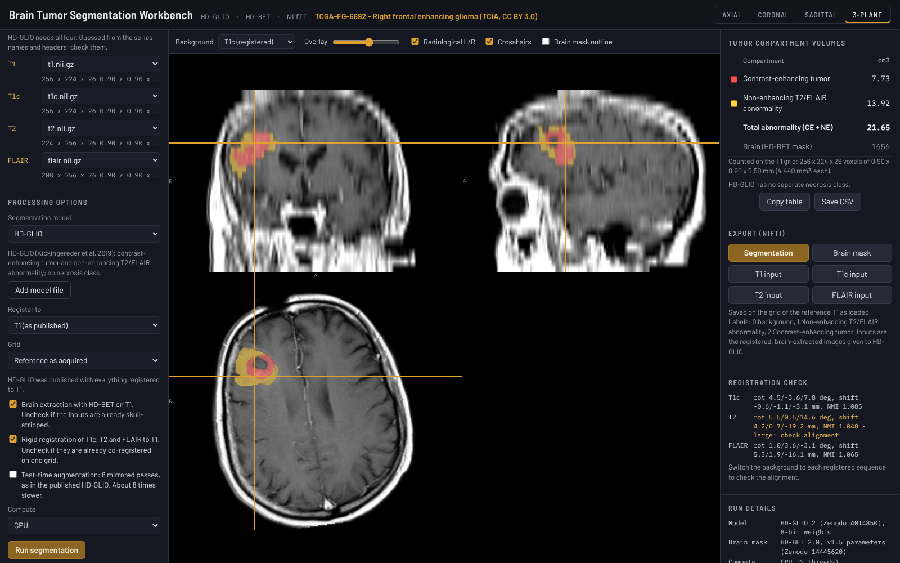

# Brain Tumor Segmentation Workbench

A standalone, offline tool for automated brain tumor segmentation with **HD-GLIO**
(Kickingereder, Isensee et al., Lancet Oncol 2019) or, as an add-on, the **nnU-Net BraTS 2020**
model (Isensee et al.), which also separates necrosis. Drop in a DICOM folder, a `.zip` or NIfTI
files. It finds the T1, T1c, T2 and FLAIR series, prepares them as the HD-GLIO instructions
prescribe (reorientation, HD-BET brain extraction, rigid registration to a reference sequence,
masking), runs the chosen model and shows the result on a 3-plane viewer with the compartment
volumes in cm3. The segmentation and the prepared inputs are saved as NIfTI. All processing
happens on the computer it runs on.



## What it measures

| Label | Compartment | Model class name |
|---|---|---|
| 1 | Non-enhancing T2/FLAIR signal abnormality | `edema` |
| 2 | Contrast-enhancing tumor | `km` (Kontrastmittel) |
| 1 + 2 | Total abnormality | |

HD-GLIO has no separate necrosis class. The **nnU-Net BraTS 2020** add-on uses the BraTS label
convention:

| Label | Compartment |
|---|---|
| 1 | Necrosis / non-enhancing tumor core (NCR) |
| 2 | Peritumoral edema / infiltrated tissue (ED) |
| 4 | Enhancing tumor (ET) |
| 1 + 4 | Tumor core (TC) |
| 1 + 2 + 4 | Whole tumor (WT) |

The volumes table lists each compartment in cm3, counted on the grid of the reference sequence,
plus the HD-BET brain volume. **Copy table** and **Save CSV** export it. The CSV carries the model,
grid and options used, and no patient information.

## Download

The ready-to-run files are in [`downloads/`](downloads). Nothing needs to be installed and no
admin rights are needed.

| File | Runs on | Size |
|---|---|---|
| [`BrainTumorSegmentationWorkbench.exe`](downloads/BrainTumorSegmentationWorkbench.exe) | Windows 10/11 (x64) | 71 MB |
| [`BrainTumorSegmentationWorkbench-macOS-AppleSilicon.zip`](downloads/BrainTumorSegmentationWorkbench-macOS-AppleSilicon.zip) | macOS 11+, Apple M-series | 67 MB |
| [`BrainTumorSegmentationWorkbench-macOS-Intel.zip`](downloads/BrainTumorSegmentationWorkbench-macOS-Intel.zip) | macOS 11+, Intel | 67 MB |
| [`BrainTumorSegmentationWorkbench-model-BraTS2020-nnUNet.btsmodel`](downloads/BrainTumorSegmentationWorkbench-model-BraTS2020-nnUNet.btsmodel) | Optional add-on model for any of the above | 58 MB |

**Add-on model.** To use the nnU-Net BraTS 2020 model, download the `.btsmodel` file and put it
in the same folder as the program (for example both in Downloads). It then appears under
*Processing options > Segmentation model*. Alternatively open it with **Add model file** (for
that session only). It is a separate file because the program and both models together would
exceed GitHub's 100 MB file limit. The file is checked (format and checksum) before use.

Each file contains everything: the page, the viewer, ONNX Runtime and both networks.

Checksums: [`downloads/SHA256SUMS.txt`](downloads/SHA256SUMS.txt).

**Windows:** double-click the `.exe`. On first run SmartScreen may say "Windows protected your
PC". Click **More info**, then **Run anyway**. The workbench opens in its own Edge (or Chrome)
window and the program quits by itself about 30 seconds after that window is closed.

**macOS:** unzip, then double-click **Brain Tumor Segmentation Workbench**. The first time,
macOS blocks it because it is not signed by a registered developer: open **System Settings >
Privacy & Security** and click **Open Anyway**.

A run needs about 3 GB of free memory (the browser holds the volumes and the network's 128^3
patches).

The executables are unsigned. Workstations that allow only approved software may block them
until IT approves them.

## Using it

1. **Load a study.** Drop a DICOM folder or `.zip`, or four NIfTI files, or pick the demo case.
   DICOM may be uncompressed, RLE, JPEG lossless, JPEG-LS or JPEG 2000, single- or multi-frame
   (enhanced MR). Series with fewer than 3 slices are skipped; localisers, diffusion, perfusion
   and other series are listed but not assigned automatically.
2. **Check the sequences.** T1, T1c, T2 and FLAIR are guessed from the series descriptions and
   headers (TR, TE, TI, contrast agent) or the NIfTI file names. When three are recognised and
   exactly one series is left over, it takes the remaining slot and is marked *by elimination -
   check it*. Change any of them in the drop-downs.
3. **Options.**
   - *Segmentation model*: HD-GLIO (built in) or an add-on model such as nnU-Net BraTS 2020.
   - *Register to*: the reference sequence. T1, as HD-GLIO was published, or T1c or FLAIR, for
     example when that sequence has the thinnest slices. HD-BET runs on the reference, the other
     three are registered to it, and the volumes and exports are on its grid. The brain-mask
     volume depends on which sequence HD-BET sees, so compare brain volumes only within one
     choice.
   - *Grid*: the reference as acquired, or resampled to 1 mm isotropic.
   - *Brain extraction with HD-BET*: switch off if the inputs are already skull-stripped.
   - *Registration*: switch off if the four images are already co-registered on one grid. It is
     switched off automatically when four NIfTI files share one grid.
   - The reference, grid and model choices are remembered in this browser.
   - *Test-time augmentation*: the published HD-GLIO averages 8 mirrored predictions. It is off by
     default because it takes about 8 times longer; switch it on to reproduce the published
     setting exactly.
   - *Compute*: automatic uses the GPU through WebGPU when there is one, otherwise the CPU. If
     the GPU stops responding during a run, that step restarts on the CPU and the run finishes
     there (see Troubleshooting).
4. **Run segmentation.** Progress is shown per step. On the CPU of a 2-core test machine the
   demo case took 9 minutes (HD-BET 5.4 min, registration 0.7 min, HD-GLIO 2.9 min), or 32
   minutes with test-time augmentation. More CPU cores, or a GPU through WebGPU, make it
   considerably faster.
5. **Review.** Axial, coronal, sagittal (anterior to the left) or 3-plane view. Choose the
   background sequence, the overlay opacity, crosshairs on or off, and which compartments are
   shown (click a colour swatch). The *Registration
   check* lists each sequence's rotation and shift and flags large ones. Switch the background
   to each registered sequence to confirm the alignment.
6. **Export.** Segmentation, brain mask and the four prepared inputs as `.nii.gz`. Files are on
   the reference grid with the same voxel order and orientation as the reference series that was
   loaded, so they overlay it in any viewer.

## Troubleshooting

**"The GPU stopped responding" / "[Device] is lost".** The browser lost its GPU while a network
was running. On Windows this is usually the graphics driver's 2-second timeout (TDR): one
network layer on a 3D patch can take longer than that on integrated or modest GPUs, and Windows
then resets the GPU. Running out of GPU memory has the same effect. Since version 1.0.1 the
workbench restarts that step on the CPU and finishes the run there (same result, slower), keeps
using the CPU for the rest of the session, and remembers it on that computer: *Automatic* then
uses the CPU. Choose *GPU* under *Compute* to try the GPU again. With version 1.0.0 the run
stopped with this error; choose *CPU* under *Compute* to avoid it.

## Pipeline

Following the [HD-GLIO instructions](https://github.com/NeuroAI-HD/HD-GLIO):

| Step | HD-GLIO instructions (FSL / Python) | Workbench |
|---|---|---|
| Reorient | `fslreorient2std` | Axis permutation and flips to the MNI152 voxel order (LAS), exact |
| Brain mask | `hd-bet` on T1 | HD-BET 2.0 (v1.5 parameters) on the reference (T1 by default; T1c or FLAIR if chosen); largest connected component kept |
| Registration | `flirt -dof 6 -interp spline` to T1 | 6-parameter rigid registration to the reference by normalised mutual information (coarse search at 4 mm, then 6 / 3 / 1.5 mm), cubic B-spline resampling |
| Masking | `fslmaths -mas` with the T1 brain mask | Same, with the reference's brain mask |
| Segmentation | `hd_glio_predict` (nnU-Net v1, fold 0) | The same network and nnU-Net v1 prediction steps reimplemented in JavaScript (see VERIFICATION.md). The BraTS add-on runs through the same code, with nnU-Net's region-based output handling |

**Agreement with the original models** (demo case, identical inputs, PyTorch on CPU as the
reference; details in [VERIFICATION.md](VERIFICATION.md)): HD-GLIO differs at 18 of 1.49 million
voxels (Dice 0.9989 enhancing, 0.9971 non-enhancing; volumes within 0.08 cm3). With test-time
augmentation on both sides, 22 voxels differ (Dice 0.9991 / 0.9965). The HD-BET mask differs at
184 boundary voxels (Dice 0.99975). The nnU-Net BraTS 2020 add-on differs from the original
PyTorch network at 1 voxel (Dice 1.0 for ET, NCR and TC; 0.99991 for ED).

**Weight precision.** HD-GLIO and HD-BET are stored as 8-bit integers per output channel and
restored to 32-bit floating point at load, which keeps the executable under GitHub's 100 MB file
limit. The add-on model is stored at 16-bit precision. The agreement figures above are for the
shipped files.

**About the BraTS model.** It is one network (fold 0) of the region-based configuration
(`nnUNetTrainerV2BraTSRegions_DA4_BN_BD`) of Isensee et al.'s BraTS 2020 entry, which won the
challenge as an ensemble of 25 such networks; a single network is expected to score slightly
lower than that ensemble. BraTS training images were registered to the SRI24 atlas; the
workbench runs the model in native space, on the same prepared inputs as HD-GLIO.

The networks run with [ONNX Runtime Web](https://onnxruntime.ai): WebGPU when available,
otherwise multi-threaded WebAssembly on the CPU.

## Privacy and offline use

- Works with no internet connection. The demo case and a DICOM study were tested end to end in a
  sandbox with no network.
- No imaging data or patient information is sent anywhere. The program makes **no** outbound
  requests: fonts, viewer, runtime and networks are all inside the executable, and the page's
  Content-Security-Policy stops the browser from connecting anywhere but the local server.
- The built-in server listens on `127.0.0.1` only, accepts no uploads, and refuses requests
  addressed to any other host name. Besides its own embedded files, it reads only `.btsmodel`
  add-on files in its own folder, by exact name.
- Output files contain no DICOM header information: file names are fixed
  (`hdglio_segmentation.nii.gz`, ...) and the NIfTI description field names only the content.

See [VERIFICATION.md](VERIFICATION.md) for the method and results.

## How it works

The workbench is a web page (`app/`) whose processing runs in a Web Worker: DICOM decoding,
registration, nnU-Net pre- and post-processing and the networks. The executable is a small Go
program that embeds the page, the viewer, ONNX Runtime and both networks. When it starts it
serves them from `http://127.0.0.1:47821/` (another free port if that one is busy), opens a
chromeless Edge or Chrome window, and exits shortly after the last window closes.

## Building

Requires Go 1.22+ and Python 3 with PyTorch, nnU-Net v1 (`nnunet`), nnU-Net v2 (`nnunetv2`),
`onnx` and Pillow.

```bash
# 1. trained parameters (from Zenodo, see THIRD_PARTY_NOTICES.md), unzipped
build/export_models.py hdglio weights_src/hd_glio_params --q8
build/export_models.py hdbet  weights_src/hdbet_params   --q8
build/export_models.py brats2020 weights_src/brats2020/<...>/nnUNetTrainerV2BraTSRegions_DA4_BN_BD__nnUNetPlansv2.1_bs5 --out addons/brats2020   # optional add-on
# 2. executables
build/build.sh        # -> dist/BrainTumorSegmentationWorkbench.exe, dist/*-macOS-*.zip, dist/*.btsmodel, dist/btsw-linux-amd64
```

`build/build.sh` is reproducible: the same sources and exported models give byte-identical
executables and add-on files.

## Testing (Linux)

```bash
python3 test/make_dicom.py app/demo/tcga-fg-6692 test/out/dicom_canary  # multi-syntax DICOM with canary patient tags
unshare -rn test/offline_run.sh                     # full workflow with no network at all
python3 test/serve.py app 8771 &                    # development server
node test/e2e.mjs http://127.0.0.1:8771/ test/out/e2e   # end-to-end in headless Chrome
python3 test/validate/compare_hdglio.py weights_src/hd_glio_params test/out/e2e   # vs PyTorch HD-GLIO
node test/e2e.mjs http://127.0.0.1:8771/ test/out/e2e-brats --model brats2020   # add-on (serve.py ... --addons DIR)
python3 test/validate/compare_brats.py <BraTS 2020 model folder> test/out/e2e-brats   # vs PyTorch nnU-Net
node test/gpu_loss_test.mjs http://127.0.0.1:47821/ test/out/gpu-loss   # GPU reset mid-run -> CPU fallback
node test/unit/roles_test.mjs                       # sequence assignment from file names
```

## Repository layout

```
app/          the workbench page, worker, libraries, networks (models/) and demo case
launcher/     Go launcher that embeds app/ and serves it locally
build/        model export, site preparation, icon and Windows resources, build script
test/         end-to-end, offline, DICOM and numerical validation tests
docs/         screenshots
downloads/    ready-to-run executables (built by build/build.sh)
```

Third-party components, model licenses and demo data: [THIRD_PARTY_NOTICES.md](THIRD_PARTY_NOTICES.md).
The HD-BET parameters are licensed CC BY-NC 4.0, so the executables are for non-commercial use.

*Research software, not a medical device. Not for clinical decision-making.*
